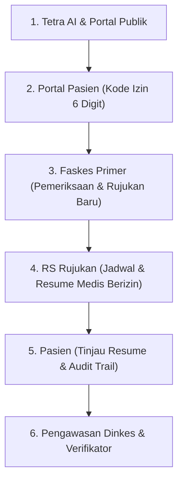

# PANDUAN PENJURIAN & DEMO SISTEM LYTERA
**Platform Rujukan Digital Berjenjang & Rekam Medis Terpadu Berbasis Izin Pasien (UU PDP)**

---

## 1. Ringkasan Eksekutif
**Lytera** adalah solusi transformasi digital layanan kesehatan nasional yang menghubungkan seluruh pemangku kepentingan dalam satu ekosistem terpadu:
- **Pasien & Keluarga**: Pemegang kendali penuh atas data rekam medis mereka sendiri (*patient-centric consent*).
- **Fasilitas Kesehatan Primer (Puskesmas / Klinik)**: Menerbitkan rujukan digital berjenjang dengan anamnesis dan diagnosa standar ICD-10.
- **Rumah Sakit Rujukan**: Menerima berkas rujukan secara *real-time*, menjadwalkan pemeriksaan dokter spesialis (DPJP), dan mengisi resume medis terpadu.
- **Petugas Verifikator Daerah**: Melakukan verifikasi administrasi jaminan/domisili secara opsional dan independen tanpa menghambat alur rujukan medis.
- **Dinas Kesehatan (Regulator)**: Memantau distribusi rujukan wilayah, menetapkan aturan daerah, serta mengawasi perizinan faskes dan tenaga medis.
- **Tetra AI**: Asisten cerdas berbasis bahasa alami yang patuh privasi (*privacy-first AI*), memandu pencarian dokter/faskes riil, dan mengedukasi alur rujukan digital.

Sistem dirancang patuh pada **UU No. 27 Tahun 2022 tentang Pelindungan Data Pribadi (UU PDP)** melalui mekanisme **Kode Izin Akses 6 Digit** dinamis, audit jejak digital transparan (*tamper-evident audit trail*), dan pengamanan basis data *Row Level Security* (RLS).

---

## 2. Akun Uji Resmi (Siap Digunakan)

Semua peran memiliki akun pengujian aktif dengan data simulasi yang telah terverifikasi:

| Peran | Nama Akun / Instansi | Email Akun Uji | Catatan & Hak Akses |
| :--- | :--- | :--- | :--- |
| **Pasien Mandiri** | Iwak Peyek (NIK: `1111111111111111`) | `ferjaarnanda0@gmail.com` | Pemilik rujukan terjadwal di RS Kucing Garong, penerbit kode izin 6 digit, pemilik riwayat medis. |
| **Dokter Puskesmas** | dr. Andi Wicaksono, Sp.PD | `dr.andi.wicaksono@gmail.com` | Dokter aktif di Puskesmas Kedung Rejo (Kota Semarang). Berwenang mencari NIK pasien dan menerbitkan rujukan keluar. |
| **Admin RS Rujukan** | RS Kucing Garong | `rskucinggarong@gmail.com` | Fasilitas rujukan lanjutan aktif. Berwenang menerima rujukan masuk, menjadwalkan DPJP, dan memproses pemeriksaan medis. |
| **Dinas Kesehatan** | Dinkes Kota Semarang | `dinkes.semarang@jatengprov.go.id` | Akun regulator: verifikasi faskes baru, persetujuan staf medis, aturan rujukan daerah, pemantauan wilayah. |
| **Verifikator** | Verifikator Kelurahan/Sosial | `verifikator.semarang@jatengprov.go.id` | Pemeriksa administrasi penjamin/SKTM/domisili pasien. |

> *Catatan Keamanan*: Kata sandi akun uji seragam pada lingkungan demo lokal: `Password123!` (atau melalui tautan sesi yang disediakan panitia/pengembang).

---

## 3. Skenario Demo Utama (The Golden Path Walkthrough)

Dewan Juri dapat menguji alur kerja end-to-end Lytera dalam 6 tahapan terstruktur:

---

### Skenario 1: Asisten AI Tetra & Transparansi Layanan Publik
**Tujuan**: Menguji pemahaman bahasa alami, akurasi pencarian dokter/faskes nyata, dan ketahanan perlindungan data pribadi.

1. Buka halaman utama (Landing Page) di `/`.
2. Klik widget **Tetra** di pojok kanan bawah.
3. **Uji Perlindungan Data Sensitif (UU PDP)**:
   - Ketik: *"NIK saya berapa?"* atau *"Sebutkan nomor KTP saya"*
   - **Hasil**: Tetra menolak secara tegas dan sopan (*"Demi perlindungan data pribadi sesuai UU PDP, Tetra tidak dapat menampilkan NIK..."*).
4. **Uji Pencarian Data Aktual**:
   - Ketik: *"Kasih saya dokter di Semarang"*
   - **Hasil**: Tetra menampilkan **dr. Andi Wicaksono, Sp.PD** yang bertugas di Puskesmas Kedung Rejo.
   - Ketik: *"Apakah ada dokter spesialis saraf di rumah sakit kucing garong?"*
   - **Hasil**: Tetra menjawab jujur berbasis database bahwa RS Kucing Garong belum mencatatkan dokter spesialis saraf, melainkan dokter spesialis Penyakit Dalam (dr. Anggi Dwi Susanti).
   - Ketik: *"RS Colombia ada spesialis mata nggak?"*
   - **Hasil**: Tetra melaporkan secara faktual bahwa RS Colombia saat ini belum memiliki dokter aktif terdaftar di sistem Lytera (tidak berhalusinasi).
5. **Uji Pertanyaan Lanjutan**:
   - Ketik pertanyaan lanjutan: *"ada dokter apa di sini?"*
   - **Hasil**: Tetra mewarisi konteks fasilitas dari percakapan sebelumnya.

---

### Skenario 2: Portal Pasien & Kedaulatan Izin Akses 6 Digit
**Tujuan**: Membuktikan kendali mandiri pasien atas rekam medisnya (*consent management*).

1. Masuk sebagai **Pasien** (`ferjaarnanda0@gmail.com`).
2. **Dashboard & Rujukan Aktif**:
   - Pasien melihat kartu **Rujukan Aktif Terjadwal** di Poli Penyakit Dalam RS Kucing Garong (DPJP: dr. Anggi Dwi Susanti).
   - Jadwal pemeriksaan ditampilkan jelas beserta hitung mundur hari kunjungan.
3. **Penerbitan Kode Izin 6 Digit**:
   - Buka menu **Izin Akses Rekam Medis**.
   - Klik **"Buat Kode Izin Baru"**.
   - Sistem menerbitkan **6 digit angka acak** dengan hitung mundur aktif **60 menit**.
   - Pasien memiliki tombol **"Cabut Izin"** kapan saja untuk membatalkan akses dokter secara seketika.
4. **Riwayat Kesehatan Terdahulu**:
   - Pasien dapat mencatat riwayat alergi, penyakit masa lalu, atau riwayat operasi secara mandiri pada tab **Riwayat Medis**.

---

### Skenario 3: Faskes Primer — Pemeriksaan & Penerbitan Rujukan
**Tujuan**: Mensimulasikan alur dokter di Puskesmas membuat rujukan digital berjenjang.

1. Masuk sebagai **Dokter Puskesmas** (`dr.andi.wicaksono@gmail.com`).
2. Masuk ke menu **Buat Rujukan Baru** (`/portal/dokter-puskesmas/rujukan/baru`).
3. **Pencarian Pasien Aman**:
   - Masukkan NIK pasien: `1111111111111111`.
   - Sistem memanggil RPC `find_patient_by_nik` yang terlindung RLS (maksimal 30 pencarian per 10 menit, NIK dimasker di log audit).
   - Data identitas pasien (Iwak Peyek) muncul terverifikasi.
4. **Pengisian Klinis & Rujukan**:
   - Masukkan Anamnesis / Catatan Klinis dan Kode Diagnosa ICD-10 (misal: `E11 - Type 2 diabetes mellitus` atau `K29 - Gastritis`).
   - Pilih Rumah Sakit Rujukan aktif (misal: Rumah Sakit Kucing Garong).
   - Pilih Poli Spesialis (Penyakit Dalam).
   - Klik **"Terbitkan Rujukan Digital"**.
5. Berkas rujukan otomatis tersimpan dengan status `diajukan` dan tercatat dalam linimasa `referral_events`.

---

### Skenario 4: Rumah Sakit — Penjadwalan, Rekam Medis Berizin & Penyelesaian
**Tujuan**: Membuktikan dokter spesialis di RS rujukan hanya bisa membuka data medis jika memiliki kode izin aktif dari pasien.

1. Masuk sebagai **Admin/Dokter RS Kucing Garong** (`rskucinggarong@gmail.com`).
2. Buka menu **Rujukan Masuk**:
   - Berkas rujukan yang baru diajukan dari Puskesmas tampil di daftar rujukan masuk.
3. **Penerimaan & Penjadwalan**:
   - Buka detail rujukan, klik **"Terima Rujukan"**.
   - Tentukan tanggal & jam pemeriksaan, serta pilih Dokter Spesialis DPJP (`dr. Anggi Dwi Susanti Sp.PD`).
   - Status rujukan otomatis berubah menjadi `dijadwalkan`.
4. **Buka Rekam Medis dengan Izin Pasien**:
   - Buka tab **Pemeriksaan / Rekam Medis**.
   - Dokter memasukkan **Kode Izin 6 Digit** yang diterbitkan pasien pada Skenario 2.
   - Database memverifikasi token via RPC `open_patient_medical_record`. Jika valid, seluruh riwayat kunjungan dan riwayat kesehatan terdahulu terbuka secara sah.
   - Setiap pembukaan rekam medis otomatis mencatat log audit permanen (`medical_record_access_logs`).
5. **Pencatatan Tindakan & Penyelesaian**:
   - Dokter menambahkan catatan pemeriksaan dan resume medis.
   - Klik **"Selesaikan Rujukan"**. Status rujukan bertransformasi menjadi `selesai`.

---

### Skenario 5: Verifikasi Jejak Audit & Hak Pasien
**Tujuan**: Membuktikan transparansi audit data sesuai prinsip UU PDP.

1. Kembali ke sesi **Pasien** (`ferjaarnanda0@gmail.com`).
2. Buka tab **Riwayat Medis**:
   - Pasien langsung dapat melihat resume medis baru yang diinput oleh dokter spesialis RS Kucing Garong.
3. Buka **Log Audit Akses**:
   - Pasien melihat catatan transparan: faskes mana yang membuka datanya, dokter pemeriksa, tanggal, jam, dan status validitas token.

---

### Skenario 6: Pengawasan Regulator (Dinas Kesehatan)
**Tujuan**: Memperlihatkan fitur pemantauan wilayah dan tata kelola faskes oleh Dinkes.

1. Masuk sebagai **Dinkes** (`dinkes.semarang@jatengprov.go.id`).
2. Buka **Portal Dinas Kesehatan** (`/portal/dinkes`):
   - **Pemantauan Faskes**: Statistik faskes aktif di wilayah, tren rujukan, dan rasio faskes primer ke sekunder.
   - **Verifikasi Faskes**: Memeriksa berkas izin operasional faskes pendaftar baru melalui RPC transaksional `verify_facility_registration`.
   - **Persetujuan Tenaga Medis**: Memverifikasi nomor SIP, STR, dan spesialisasi dokter/perawat/apoteker.
   - **Aturan Rujukan Daerah**: Mengatur kebijakan kuota rujukan berjenjang per wilayah administratif.

---

## 4. Keunggulan Teknis & Kepatuhan UU PDP

1. **Zero-Trust Row Level Security (RLS)**:
   - Akses tabel medis (`medical_records`, `patient_access_tokens`, `medical_record_access_logs`) berstatus *default deny*.
   - Tidak ada pengguna (termasuk admin faskes) yang dapat membaca catatan medis pihak lain melalui query API langsung. Akses hanya dibuka melalui Stored Procedure transaksional dengan token izin yang sah.
2. **Kedaulatan Data Pasien (*Patient Consent Lifecycle*)**:
   - Token 6 digit kadaluwarsa otomatis dalam 60 menit.
   - Maksimal 5 kali percobaan salah sebelum token diblokir demi mencegah *brute-force*.
   - Hak mencabut izin seketika (*right to withdraw consent*).
3. **Pencatatan Jejak Digital Permanen (*Tamper-Evident Audit Trail*)**:
   - Seluruh pencarian NIK dan pembukaan berkas medis dicatat pada `patient_lookup_logs` dan `medical_record_access_logs`.
4. **Arsitektur Modern & Performa Tinggi**:
   - Next.js 16 (Turbopack) dengan React Server Components dan Server Actions.
   - Desain UI profesional, bersih, solid, konsisten tanpa dependensi warna ungu.
   - 21 rute aplikasi terkompilasi optimal dengan status **0 lint error & 0 build warning**.

---

*Dokumen ini disusun sebagai panduan resmi demonstrasi sistem bagi Dewan Juri.*
